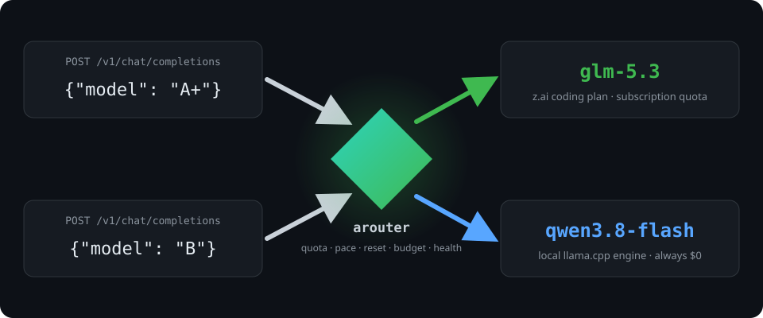

<p align="center"></p>

# arouter

**Delegate quota control to arouter.** Connect your LLM subscriptions, local engines and paid API keys once — from then on your tools just ask for a *quality grade* (`A+`, `A`, `B`) and arouter serves each request from whichever model makes sense *right now*: the subscription with the healthiest quota, the warm local engine, or — only if you allow it — the cheapest paid API that still fits the budget.

<p align="center"></p>

Both requests above hit the same endpoint at the same time. The `A+` request landed on a subscription model with quota to burn; the `B` request on a local engine that costs nothing. Nobody picked those models — arouter did, and every response tells you where it went (`X-Arouter-Upstream`, `X-Arouter-Grade`, `X-Arouter-Pool`).

## Why

If any of this sounds familiar:

- you keep a mental map of which coding-plan quota resets when, and hit the wall mid-task;
- overnight agents burn pay-per-token keys because you forgot to repoint them at the subscription;
- your GPU sits idle while you wait out a 429.

…arouter exists so you can stop doing all three:

- **Spend subscriptions first** — every quota window (used %, reset time, burn pace) is tracked live; the healthiest key serves each request; leftover quota on a window that's about to reset is deliberately drained — use it or lose it.
- **Park cheap work locally** — low grades land on warm local models (ollama, llama.cpp, strata): already-resident models are preferred, KV caches stay hot, busy engines are skipped.
- **Guard the paid pool** — on-demand APIs serve only as an explicit, budget-capped fallback: daily / monthly / hourly-pace / per-request caps stack (tightest wins), ordering is cheapest-within-grade, and refusals are a `402` naming the exact layer and spend. Admission is atomic — accepted estimates are *reserved* until the real cost lands, so concurrent requests can't oversubscribe a cap. No surprise bills, ever.
- **Never hang on a stalled upstream** — response-header, body-read, and SSE chunk-gap deadlines (`[timeouts]`, defaults 60s/120s) cut a stuck upstream and fail over to the next candidate; attempts per request are capped (`max_attempts`, default 3).
- **Attribute everything** — per-caller keys give you usage, spend and budgets per person or per agent.

v0.1 — battle-tested as a daily driver: routing all of the above through one daemon, with an htop-style live monitor, Prometheus metrics, a provisioned Grafana dashboard, and a 37-check black-box Docker test rig.

## Quickstart

```bash
cargo build --release
./target/release/arouter serve --config config.example.toml   # daemon on 127.0.0.1:3929

curl -s localhost:3929/v1/chat/completions \
  -d '{"model":"arouter-subscription-A+","messages":[{"role":"user","content":"hi"}]}'
curl -s localhost:3929/v1/models        # → arouter-subscription-A+, …
```

Point any OpenAI-compatible client at `http://localhost:3929/v1` with a
group-grade model id (`arouter-subscription-A+` …) — see
[Routing groups](#what-it-decides). Bare grade tokens (`A+`, `A`, `B`)
remain the power-user shorthand for the URL's pool. Upstream accounts go in `~/.config/arouter/.env` (or the environment); edit `config.example.toml` for which models exist and at what grade. Anthropic-wire clients (Claude Code, `anthropic-messages`) work too — see below. pi users get providers wired automatically by `arouter init`.

## What it decides

**Routing groups — the easy surface.** `/v1/models` lists one entry per group×grade (config-defined `[[groups]]` × the group ladder), defaults: `arouter-subscription-A+`, `arouter-subscription-A`, …, `arouter-local-*`, `arouter-ondemand-*` — one group per pool, subscription and on-demand falling back to local. Send `"model": "arouter-subscription-A+"` to pin that grade inside the group; the bare id (`"model": "arouter-subscription"`) delegates the whole ladder to the routing strategy, and a range like `arouter-subscription-A+..A` caps degradation. Explicit-member groups can mix providers and pools: models at the same group grade are considered together by the routing heuristic. A group's fallback pools are consulted only if it has no eligible member at the requested grade.

For a request that should use one configured upstream directly, send its exact model id (for example `codex/gpt-6-astra`). arouter pins that model and still checks its configured pool, profile visibility, quota, health, context, and budget before sending the request.

**Grades, pools, profiles.** You request `A+`, `A`, `B` — or a range like `"A+..A"` to cap degradation. Pools are hard boundaries: `/v1` = your subscriptions/quotas (default), `/local/v1` = local engines, `/ondemand/v1` = pay-per-token. Profiles add per-task overlays via the URL path (`/night/v1/...`): their own ladder, budgets and model visibility. Falling back from a free pool into a paid one is explicit opt-in (`cross_pool = ["ondemand"]`) and always labeled in the response. (Grade tokens and pool paths remain the power-user surface; groups are what clients see.)

**Quota awareness.** arouter asks its upstreams for quota directly: the documented OpenRouter key endpoint by default, `x-ratelimit-*` headers harvested from the responses it already proxies (a 429 is ground truth — exhausted until its `Retry-After` says otherwise), an opt-in fetcher for z.ai coding plans, and hand-pinned windows for providers with no quota API at all. It then scores each provider: exhausted windows are skipped until their reset (arouter's own 429 carries a reset-aware `Retry-After`), scarce windows and too-fast burn rates are deprioritized, equally-healthy providers spread by remaining headroom. Windows resetting within 4h enter **drain mode** — penalties lift and ties resolve toward the soonest reset, so expiring quota gets spent instead of wasted. Live numbers: `/status.json` and the `arouter_quota_*` gauges.

**On-demand budgets.** Chargeable attempts pass stacked spend guards before leaving arouter: pool budget, per-profile budget, per-caller daily cap — tightest wins. Responses carry `X-Arouter-Cost-Usd` and `X-Arouter-Budget-Remaining-Today`.

**Local engine smarts.** arouter polls ollama (`/api/ps`) and llama.cpp/strata (`/slots`): requests prefer models that are already resident (no multi-second cold loads), skip engines mid-generation, and stick to the model that just served a caller (warm KV cache). All of it only reorders *within* a grade — never across grades or pools.

**Self-healing.** Failing models cool down (30s→2m→8m→30m) and eventually trip a circuit breaker; `/status.json` shows per-model health. Discovery polls upstreams for new models every few minutes and grades them from an embedded catalog (GPT, Claude, GLM, Gemini, Qwen, Llama…) plus a price/keyword heuristic — manual entries always win. `kill -HUP` hot-reloads config without dropping the daemon.

## Watch it work

```sh
arouter monitor          # htop-style TUI: provider LEDs with reset countdowns,
                         # per-model quota bars, tok/s, 24h sparklines, spend
```

`/metrics` speaks Prometheus (requests, tokens, $ spend, latency/TTFB histograms, quota windows, drain countdown — all labeled by caller/pool/grade). Import [contrib/grafana-dashboard.json](contrib/grafana-dashboard.json), or run the whole stack:

`arouter_requests_total` uses `status` for outcomes (`ok`, `upstream_error`, `exhausted`, …), not HTTP codes. `source_model` is the client request and `target_model` is the upstream model selected (`none` when routing exhausted); `event="request"` excludes individual retry attempts. Filter HTTP errors with `http_status`:

```promql
sum by (http_status) (rate(arouter_requests_total{event="request",http_status=~"4..|5.."}[5m]))
```

```sh
docker compose -p arouter-obs -f contrib/observability/docker-compose.yml up -d --wait
#   Grafana http://localhost:3300  ·  Prometheus http://localhost:9090
```

## Multiple developers / agents

```toml
[auth]
require = false          # true once you bind beyond loopback

[[callers]]
name    = "alice"
project = "arouter"
key     = "env:AROUTER_KEY_ALICE"   # client sends: Authorization: Bearer <key>
```

Per-caller usage, spend and caps fall out for free: `sum by (caller) (increase(arouter_cost_usd_total[1d]))` in Grafana is spend per person. arouter is plain HTTP — expose it only on trusted networks (LAN/tailnet); keys protect identity, not transport.

### API tokens

For fine-grained clients (one per agent, CI job, teammate) mint `ark_…`
tokens from the web UI's *Tokens* page or `POST /api/tokens`:

```bash
curl -s http://127.0.0.1:3929/api/tokens \
  -H 'Content-Type: application/json' \
  --cookie "arouter_sid=$SID" -X POST \
  -d '{"name":"ci","pools":["quota"],"grades":["A+","A"]}'
```

The plaintext is shown **once**; at rest only a SHA-256 hash is kept
(`tokens.toml` in the state dir, `0600`). Tokens are revocable anytime
(`POST /api/tokens/revoke`, effective immediately) and carry scopes that
only ever **narrow** access:

- `groups` — which client-facing group ids the token may address (globs)
- `pools` — hard boundary like the pool paths; no silent fallback into
  out-of-scope pools
- `grades` — allowed grades; the ladder is cut before routing
- `daily_budget_usd` — per-token UTC-day spend cap; exceeded → `429
  arouter_token_budget` with `Retry-After` until UTC midnight

An unknown, revoked or budget-exhausted token is never mapped to
anonymous: unknown/revoked → `401`, out-of-scope group → `403
  arouter_scope`, and out-of-scope upstreams are never contacted.

## Web interface

arouter serves a small web UI on the same port (`/`). There is no default
password: at startup the daemon prints a claim link under the banner.

```
web: claim http://127.0.0.1:3929/claim/<token>
```

Open it on the machine running the daemon. The link is **single-use and
loopback-only**; consuming it starts an admin session (`HttpOnly`,
`SameSite=Strict` cookie, 12h by default). Reads are gated too — the JSON
API under `/api/*` returns 401 without a session, and every write must be
same-origin. Disable the whole surface with `[web] enabled = false`.

```toml
[web]
enabled = true
session_ttl_hours = 12
```

### Managing models & quotas (E10c)

The dashboard's **models** panel drives the running router without a
restart. Changes land in an overlay (`web.toml` in the state dir —
atomic write, `0600`, picked up from hand edits within 5s) and are
re-applied on every reload, so they survive discovery polls:

- **disable / re-enable** a model — it leaves the routing set
  immediately and is never contacted (status.json lists it under
  `overlay.disabled`)
- **weight** — the within-grade sharing weight
- **add** a model (id, base_url, grade, optional pool/auth) — enters
  routing with provenance `overlay`; `ondemand` additions must carry
  costs (fail-closed, F3) and can be **removed** again. Manual and
  discovered models can be disabled but never removed from the web.

Structure (base_url, grade, pool, auth, costs, context, name) stays
manual-only — an overlay entry that tries to edit it is rejected per
entry and shows up in `/status.json` under `overlay.errors`. A
rejected write keeps the previous snapshot serving.

**Quota overrides** set synthetic `manual` samples for providers
without native quota: pick provider + window label, remaining
fraction, optional reset countdown and TTL (default 24h, max 7d).
Fresher native data supersedes an override; expiry degrades its
windows to stale. Overrides are re-applied at startup while
unexpired.

## Anthropic-wire clients

Claude Code and `anthropic-messages` clients use the same grades and pools:

```sh
curl http://127.0.0.1:3929/v1/messages -H 'content-type: application/json' \
  -H "x-api-key: $AROUTER_KEY" \
  -d '{"model":"arouter-subscription-A","max_tokens":512,"messages":[{"role":"user","content":"hi"}]}'
```

## Codex subscription models (E7)

A ChatGPT/Codex subscription can serve the quota pool natively — no API
key, no sidecar. Log in once with the Codex CLI (`codex login`), declare
the model with `wire = "codex"`, and arouter translates openai
chat-completions to the Codex Responses endpoint under the CLI's login
(re-read per request — the CLI owns renewal):

```toml
[[models]]
id   = "codex/gpt-6-astra"
grade = "A+"
pool  = ["quota"]
wire  = "codex"
```

Subscription usage limits are learned from the `x-codex-primary-*` /
`x-codex-secondary-*` response headers and feed the same quota windows
as every other provider, so exhaustion, failover and cooldowns behave
identically.

## Integration tests

A black-box Docker rig (`tests/integration/`) drives the real daemon against stub upstreams with runtime-flippable behavior (ok · stream · 500 · 429 · 400 · slow) and a fake quota feed — 37 checks covering the routing matrix: grade ladder and ranges, pool boundaries, quota-aware skips (hit counters prove an exhausted provider is never contacted), failover, budget 402 breakdowns, cross-pool fallback, SSE streaming, caller attribution, SIGHUP hot-reload, and the observability stack end-to-end.

```sh
cd tests/integration
./run.sh            # builds, runs the matrix, tears down
KEEP=1 ./run.sh     # leave the rig up for poking at localhost:3939
```

## Install

```sh
./install.sh             # release build → ~/.local/bin/arouter → runs `arouter init`
                         # PREFIX=... to target another dir, --skip-init for binary only
arouter doctor      # one-shot health report: daemon, keys, upstreams, quota watcher, pi files
arouter completions bash | sudo tee /etc/bash_completion.d/arouter
```

`arouter init` is idempotent and backs up pi's `models.json` before merging.

----

<a href="https://www.buymeacoffee.com/engzimmermy" target="_blank"></a>
